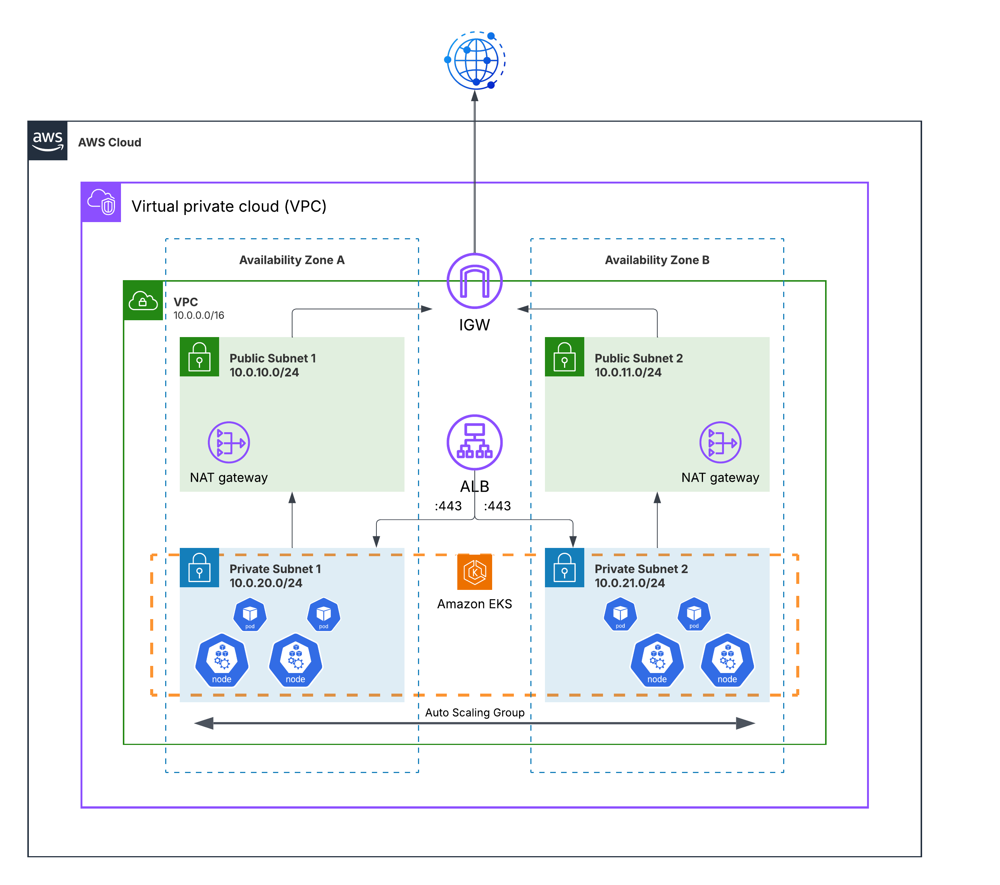
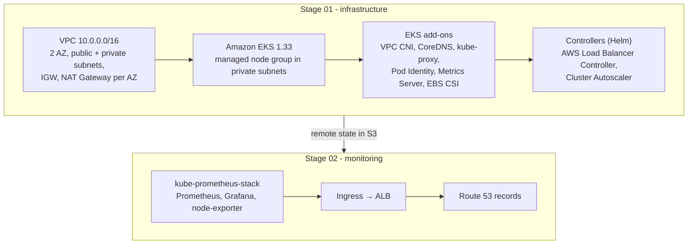
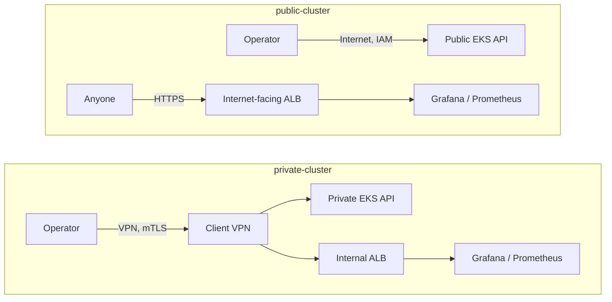
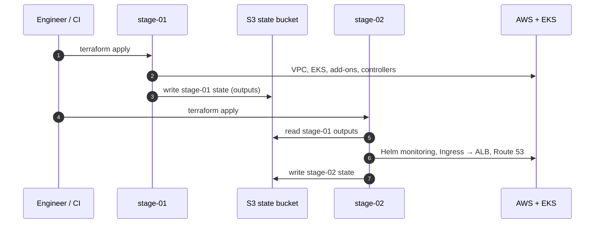

# AWS EKS Kubernetes Infrastructure

Terraform automation for Amazon EKS on AWS, in two variants that share the same building blocks:

| Project | Idea | Read more |
|---|---|---|
| [`private-cluster`](private-cluster/README.md) | **Private-by-default.** Private Kubernetes API, internal ALB and private DNS for monitoring, access only through AWS Client VPN with certificate authentication. Environments `dev` and `prod`. | [private-cluster/README.md](private-cluster/README.md) |
| [`public-cluster`](public-cluster/README.md) | **Simple and open.** Public Kubernetes API, Grafana and Prometheus published over HTTPS on an internet-facing ALB with ACM certificates. Environment `dev`. | [public-cluster/README.md](public-cluster/README.md) |



---

## Contents

1. [What both projects build](#1-what-both-projects-build)
2. [Private vs. public: differences](#2-private-vs-public-differences)
3. [Repository structure](#3-repository-structure)
4. [Two-stage deployment model](#4-two-stage-deployment-model)
5. [Terraform state](#5-terraform-state)
6. [Prerequisites](#6-prerequisites)
7. [Quick start](#7-quick-start)
8. [Which variant to choose](#8-which-variant-to-choose)

---

## 1. What both projects build



Common features:

- **Network:** VPC `10.0.0.0/16` in two availability zones; public subnets `10.0.10.0/24`, `10.0.11.0/24`; private subnets `10.0.20.0/24`, `10.0.21.0/24`; one NAT Gateway per AZ.
- **Compute:** EKS managed node group in private subnets (no public IPs), scaled by Cluster Autoscaler.
- **Identity:** EKS access entries (`authentication_mode = "API"`), EKS Pod Identity roles for the controllers, access entry for a CI/CD automation role.
- **Storage:** default `gp3` StorageClass on EBS.
- **Ingress:** AWS Load Balancer Controller creates ALBs from Kubernetes Ingress objects (target type `ip`).
- **Observability:** Prometheus + Grafana from `kube-prometheus-stack`.
- **IaC hygiene:** all resources tagged (`Environment`, `ManagedBy`, `Owner`, `Project`, `Stage`), versions pinned, state in encrypted S3 with locking.

---

## 2. Private vs. public: differences

| Area | `private-cluster` | `public-cluster` |
|---|---|---|
| Kubernetes API endpoint | Private only | Public only |
| Admin access | AWS Client VPN (mTLS, split tunnel), API port 443 open only to the VPN security group | Directly from the Internet with IAM credentials |
| Grafana / Prometheus | Internal ALB, HTTP 80, reachable only through VPN | Internet-facing ALB, HTTPS 443 with ACM certificates |
| DNS | Private Route 53 zone (split-horizon): `grafana.<env>.internal.<zone>` | Public Route 53 zone: `grafana.<env>.<zone>` |
| Security groups | Dedicated SGs for VPN, internal ALB and public ALB, SG-to-SG rules, managed by Terraform | Additional cluster SG with 80/443/3000 open to `0.0.0.0/0`; ALB rules managed by the controller |
| Extra modules | `client-vpn`, `security` | – |
| Extra add-ons | – | kube-state-metrics (EKS add-on) + ServiceMonitor |
| Logging | Client VPN connection logs in CloudWatch (30 days) | – |
| Environments | `dev`, `prod` | `dev` |
| Deployment | Network + VPN first, connect VPN, then the rest | Plain `terraform apply` per stage |



---

## 3. Repository structure

```text
.
├── README.md                     # this file
├── LICENSE
├── private-cluster/              # private-by-default variant
│   ├── README.md
│   ├── project-scheme.png
│   ├── env/
│   │   ├── dev/{stage-01,stage-02}/
│   │   └── prod/{stage-01,stage-02}/
│   └── modules/
│       ├── stage_01/{vpc,client-vpn,security,eks,ebs-csi-driver,cluster-autoscaler,lb-controller}/
│       └── stage_02/monitoring/
└── public-cluster/               # public variant
    ├── README.md
    ├── env/
    │   └── dev/{stage-01,stage-02}/
    └── modules/
        ├── stage_01/{vpc,eks,ebs-csi-driver,cluster-autoscaler,lb-controller}/
        └── stage_02/monitoring/
```

- `env/<env>/stage-0X/` – **root modules**: backend, providers, variables, module calls. This is where you run `terraform`.
- `modules/` – **reusable modules**, shared by all environments of one project.

---

## 4. Two-stage deployment model

Each environment is split into two Terraform root modules with separate state:

| Stage | Contents | Why separate |
|---|---|---|
| **Stage 01** | VPC, (VPN, SGs), EKS, add-ons, controllers | Long-lived infrastructure, changes rarely |
| **Stage 02** | Monitoring stack, Ingresses, DNS (, certificates) | Platform services, changes more often, can be recreated without touching the cluster |

Stage 02 reads Stage 01 outputs (VPC ID, subnets, cluster name and endpoint, SG IDs) through `terraform_remote_state`.



---

## 5. Terraform state

All states are stored in the S3 bucket `terraform-states-vv` (`us-east-1`), encrypted, with native S3 locking (`use_lockfile = true`):

| Project / env / stage | Key |
|---|---|
| private / dev / 01, 02 | `aws-eks-automation/private/dev/stage-01/infra.tfstate`, `.../stage-02/...` |
| private / prod / 01, 02 | `aws-eks-automation/private/prod/stage-01/infra.tfstate`, `.../stage-02/...` |
| public / dev / 01, 02 | `aws-eks-automation/public/dev/stage-01/infra.tfstate`, `.../stage-02/...` |

To use your own bucket, change the `backend "s3"` block in every `env/*/stage-0X/main.tf` and the `terraform_remote_state` block in every `stage-02/datasource.tf`.

---

## 6. Prerequisites

| Tool / resource | Needed for |
|---|---|
| Terraform `>= 1.5.7` | both |
| AWS CLI v2 with credentials that can create VPC, EKS, IAM, ELB, Route 53, ACM resources | both |
| `kubectl`, `helm` | both |
| S3 bucket for Terraform state | both |
| Public Route 53 hosted zone | both (stage-02) |
| IAM role for CI/CD automation (gets an EKS access entry) | both |
| VPN server/client certificates in ACM + OpenVPN-compatible client | `private-cluster` |

---

## 7. Quick start

Step-by-step guides with all commands are in the project READMEs. In short:

**private-cluster (dev)**

1. Create VPN certificates with easy-rsa and import them into ACM.
2. Fill in `env/dev/stage-01/terraform.tfvars` and `env/dev/stage-02/terraform.tfvars`.
3. `terraform apply -target=module.vpc -target=module.client_vpn -target=module.security -target=module.eks` in `stage-01`.
4. Export the Client VPN profile, add the client certificate, connect.
5. `terraform apply` in `stage-01`, then in `stage-02`.
6. Open `http://grafana.dev.internal.<zone>` over the VPN.

→ [private-cluster/README.md](private-cluster/README.md#7-deployment-step-by-step)

**public-cluster (dev)**

1. Create `env/dev/stage-01/terraform.tfvars` and `env/dev/stage-02/terraform.tfvars`.
2. `terraform apply` in `stage-01`, then in `stage-02`.
3. Open `https://grafana.dev.<zone>`.

→ [public-cluster/README.md](public-cluster/README.md#7-deployment-step-by-step)

---

## 8. Which variant to choose

| Use `private-cluster` when | Use `public-cluster` when |
|---|---|
| The cluster runs real workloads or customer data | You need a quick lab or demo cluster |
| Admin panels must not be visible from the Internet | Everyone on the team should reach Grafana without a VPN |
| You need an audit trail of who connected | Simplicity matters more than isolation |
| You need separate `dev` and `prod` environments | One `dev` environment is enough |

---

## Author

Valerii Vasianovych

## License

[MIT](LICENSE)
