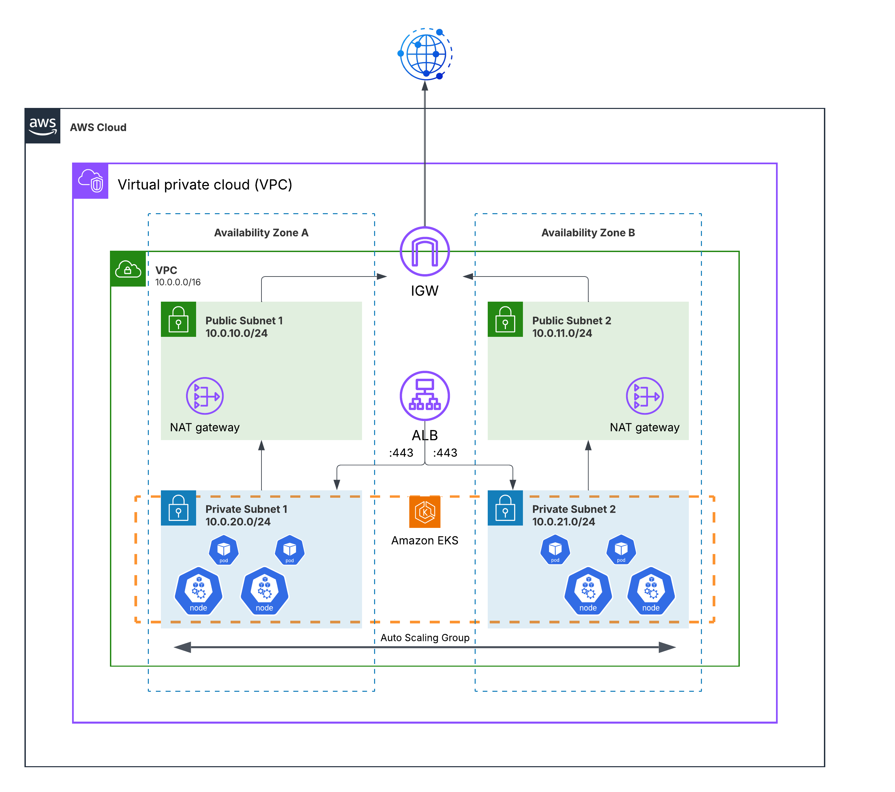
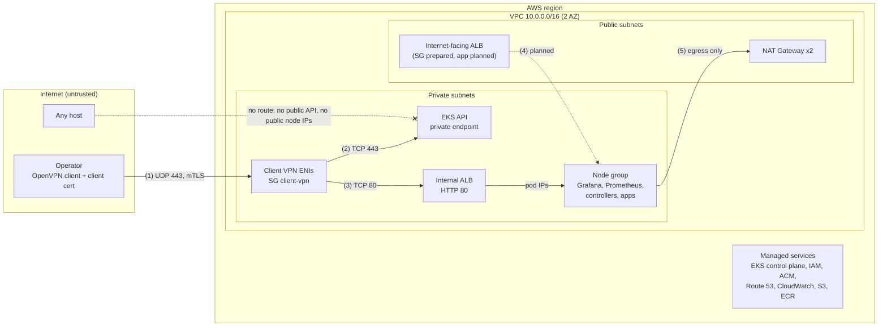
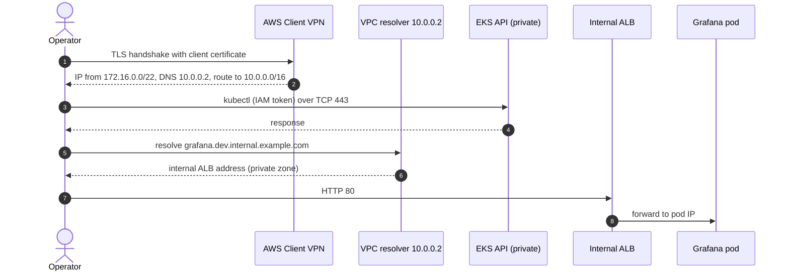
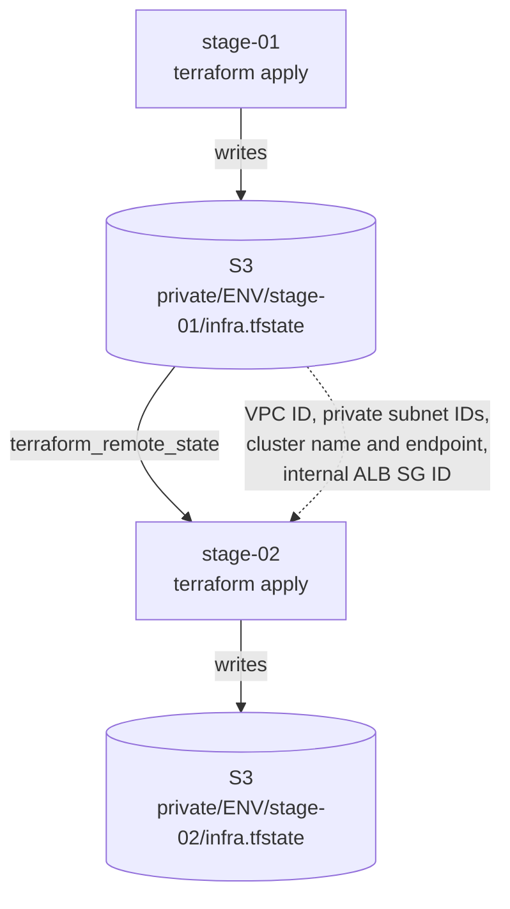
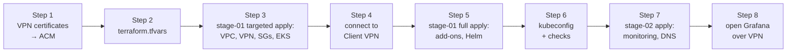

# Private EKS Cluster (private-by-default)

Terraform code for an Amazon EKS platform that has **no public administrative surface**:

- the Kubernetes API endpoint is private only,
- worker nodes sit in private subnets without public IPs,
- Grafana and Prometheus sit behind an **internal** ALB with private DNS names,
- operators get in through **AWS Client VPN** with mutual TLS (certificate) authentication.

Two environments (`dev`, `prod`) are deployed from the same modules in two stages.



---

## Contents

1. [Architecture](#1-architecture)
2. [Traffic flows and access model](#2-traffic-flows-and-access-model)
3. [Directory structure](#3-directory-structure)
4. [Modules](#4-modules)
5. [Environments](#5-environments)
6. [Prerequisites](#6-prerequisites)
7. [Deployment step by step](#7-deployment-step-by-step)
8. [Day-2 operations](#8-day-2-operations)
9. [Destroying the environment](#9-destroying-the-environment)
10. [Known issues](#10-known-issues)

---

## 1. Architecture

| Layer | What is created |
|---|---|
| Network | VPC `10.0.0.0/16` in 2 AZs; public subnets `10.0.10.0/24`, `10.0.11.0/24`; private subnets `10.0.20.0/24`, `10.0.21.0/24`; Internet Gateway; one NAT Gateway + Elastic IP per AZ |
| Access | AWS Client VPN endpoint (UDP 443, client pool `172.16.0.0/22`, split tunnel, DNS `10.0.0.2`), certificate auth via ACM, connection logs in CloudWatch (30 days) |
| Kubernetes | EKS 1.33, **private endpoint only**, authentication mode `API` (access entries), managed node group in private subnets |
| Add-ons | VPC CNI, CoreDNS, kube-proxy, EKS Pod Identity Agent, Metrics Server, EBS CSI Driver |
| Controllers | AWS Load Balancer Controller, Cluster Autoscaler (both use EKS Pod Identity) |
| Storage | Default StorageClass `gp3` (EBS CSI, `WaitForFirstConsumer`, volume expansion) |
| Monitoring | `kube-prometheus-stack` (Prometheus, Grafana, node-exporter) in namespace `monitoring` |
| DNS | Route 53 **private** hosted zone (split-horizon) associated with the VPC |
| State | S3 backend, encrypted, native S3 locking (`use_lockfile = true`) |

### Security zones



---

## 2. Traffic flows and access model

| # | Flow | How it is protected |
|---|---|---|
| 1 | Operator → Client VPN | Mutual TLS: server and client certificates from ACM. Only VPC traffic goes through the tunnel (split tunnel). Every connection is logged to CloudWatch Logs. |
| 2 | VPN → Kubernetes API | `endpoint_public_access = false`. Port 443 accepts traffic only from SG `client-vpn`. Users authenticate with IAM (`aws eks get-token`) and EKS access entries. |
| 3 | VPN → Grafana / Prometheus | Internal ALB (`scheme = internal`) whose SG allows HTTP 80 only from SG `client-vpn`. Hostnames exist only in the private Route 53 zone. |
| 4 | Internet → application (planned) | Internet-facing ALB SG (80/443 from `0.0.0.0/0`) is already created in the `security` module for a future public app. |
| 5 | Nodes → Internet | Nodes have no public IPs; image pulls, Helm charts and AWS API calls go through the NAT Gateway in the same AZ. |

Security groups are managed by Terraform (`manage-backend-security-group-rules = false` on Ingress objects), so the Load Balancer Controller never opens extra ports by itself.



---

## 3. Directory structure

```text
private-cluster/
├── project-scheme.png              # network diagram
├── env/
│   ├── dev/
│   │   ├── stage-01/               # VPC, VPN, SGs, EKS, add-ons, controllers
│   │   │   ├── main.tf             # backend, providers, module calls
│   │   │   ├── variables.tf        # inputs + locals (sizes, versions)
│   │   │   ├── outputs.tf          # consumed by stage-02 via remote state
│   │   │   ├── datasource.tf
│   │   │   └── terraform.tfvars
│   │   └── stage-02/               # monitoring, private DNS, internal ALB
│   └── prod/                       # same layout, bigger node group
└── modules/
    ├── stage_01/
    │   ├── vpc/                    # VPC, subnets, IGW, NAT, routes
    │   ├── client-vpn/             # Client VPN endpoint, SG, logs, routes
    │   ├── security/               # SGs for internal and public ALB
    │   ├── eks/                    # cluster, node group, IAM, add-ons, SG rules
    │   ├── ebs-csi-driver/         # EBS CSI add-on, Pod Identity, gp3 StorageClass
    │   ├── cluster-autoscaler/     # Helm release + Pod Identity role
    │   └── lb-controller/          # Helm release + Pod Identity role
    └── stage_02/
        └── monitoring/             # kube-prometheus-stack, Ingresses, Route 53
```

---

## 4. Modules

### Stage 01 – infrastructure

| Module | Resources | Notes |
|---|---|---|
| `vpc` | `aws_vpc`, 2 public + 2 private subnets, IGW, 2 NAT GW + EIP, route tables | Subnets tagged `kubernetes.io/role/elb` / `internal-elb` for ALB discovery |
| `client-vpn` | `aws_ec2_client_vpn_endpoint`, network associations (both private subnets), authorization rule for the VPC CIDR, route to the DNS resolver, SG, CloudWatch log group | Preconditions check that both ACM certificates are in the same region as the endpoint |
| `security` | SG `alb-internal` (80 from VPN SG), SG `alb-public` (80/443 from Internet) | Egress of both SGs limited to the VPC CIDR |
| `eks` | Cluster, node group, IAM roles, OIDC provider, access entry for the CI/CD role, EKS add-ons, SG rules (VPN → API 443, ALBs → pods) | `endpoint_private_access = true`, `endpoint_public_access = false` |
| `ebs-csi-driver` | EBS CSI add-on, Pod Identity role (+ KMS permissions), `gp3` default StorageClass | Removes the default flag from the built-in `gp2` class |
| `cluster-autoscaler` | Helm chart `cluster-autoscaler`, Pod Identity role | Auto-discovers the node group by cluster name |
| `lb-controller` | Helm chart `aws-load-balancer-controller`, Pod Identity role | Creates ALBs from Ingress objects |

### Stage 02 – monitoring

| Resource | Purpose |
|---|---|
| `helm_release.kube-prometheus-stack` | Prometheus (10-day retention, 20 GiB `gp3` PVC), Grafana (20 GiB PVC), node-exporter |
| `kubernetes_ingress_v1` `grafana` / `prometheus` | Ingress group `internal` → one internal ALB, HTTP 80, target type `ip` |
| `aws_route53_zone.private` | Private zone with the same name as the public one, associated with the VPC |
| `aws_route53_record` `grafana` / `prometheus` | Aliases `grafana.<env>.internal.<zone>` and `prometheus.<env>.internal.<zone>` → internal ALB |

### How stages are connected



---

## 5. Environments

| Setting | dev | prod |
|---|---|---|
| Region (`terraform.tfvars`) | `us-east-1` | `eu-central-1` |
| Kubernetes version | 1.33 | 1.33 |
| Instance type | `t3.small` | `t3.medium` |
| Nodes min / desired / max | 2 / 2 / 10 | 4 / 4 / 12 |
| Capacity type | On-Demand | On-Demand |
| State keys | `aws-eks-automation/private/dev/stage-0X/infra.tfstate` | `aws-eks-automation/private/prod/stage-0X/infra.tfstate` |

Versions are pinned in `env/<env>/stage-01/variables.tf` (`locals`):

| Component | Version |
|---|---|
| CoreDNS / kube-proxy / VPC CNI | `v1.12.4-eksbuild.1` / `v1.33.3-eksbuild.6` / `v1.20.2-eksbuild.1` |
| Pod Identity Agent / Metrics Server / EBS CSI | `v1.3.8-eksbuild.2` / `v0.8.0-eksbuild.2` / `v1.50.1-eksbuild.1` |
| Cluster Autoscaler chart / LB Controller chart | `9.52.1` / `1.7.2` |
| kube-prometheus-stack chart (stage-02) | `75.15.0` |

---

## 6. Prerequisites

- Terraform `>= 1.5.7` (prod pins AWS provider `>= 6.59`)
- AWS CLI v2, `kubectl`, `helm`
- An OpenVPN-compatible client (AWS VPN Client or OpenVPN Connect)
- An S3 bucket for Terraform state (the code uses `terraform-states-vv` in `us-east-1`)
- A **public** Route 53 hosted zone; stage-02 creates a private zone with the same name
- An IAM role for automation (for example a GitHub Actions role); it gets an EKS access entry
- Server and client certificates for Client VPN imported into ACM **in the same region as the environment**

---

## 7. Deployment step by step

The Kubernetes API is private, so Terraform can only manage Kubernetes and Helm resources from inside the VPC. Deployment therefore goes in this order: **network and VPN first → connect to VPN → the rest**.



### Step 1 – Create VPN certificates and import them into ACM

Use [easy-rsa](https://github.com/OpenVPN/easy-rsa) to create a CA, a server certificate and a client certificate:

```bash
git clone https://github.com/OpenVPN/easy-rsa.git
cd easy-rsa/easyrsa3
./easyrsa init-pki
./easyrsa build-ca nopass
./easyrsa --san=DNS:server build-server-full server nopass
./easyrsa build-client-full client1.vpn.local nopass
```

Import both into ACM in the environment's region (`us-east-1` for dev):

```bash
aws acm import-certificate --region us-east-1 \
  --certificate fileb://pki/issued/server.crt \
  --private-key fileb://pki/private/server.key \
  --certificate-chain fileb://pki/ca.crt

aws acm import-certificate --region us-east-1 \
  --certificate fileb://pki/issued/client1.vpn.local.crt \
  --private-key fileb://pki/private/client1.vpn.local.key \
  --certificate-chain fileb://pki/ca.crt
```

Note both ARNs. Keep `client1.vpn.local.crt` and `.key` for the VPN profile in step 4.

### Step 2 – Fill in `terraform.tfvars`

`env/dev/stage-01/terraform.tfvars`:

```hcl
automation_role_arn = "arn:aws:iam::<account-id>:role/<ci-role>"
env                 = "dev"
prefix_name         = "incubator-lab"
region              = "us-east-1"

vpn_server_cert_arn = "arn:aws:acm:us-east-1:<account-id>:certificate/<server-cert-id>"
vpn_client_cert_arn = "arn:aws:acm:us-east-1:<account-id>:certificate/<client-cert-id>"
```

`env/dev/stage-02/terraform.tfvars`:

```hcl
hosted_zone_name = "example.com"
```

The cluster is named `<prefix_name>-<env>`, for example `incubator-lab-dev`.

### Step 3 – Stage 01, part 1: network, VPN and cluster

Apply only the modules that talk to AWS APIs (they do not need access to the Kubernetes API):

```bash
cd env/dev/stage-01
terraform init
terraform apply \
  -target=module.vpc \
  -target=module.client_vpn \
  -target=module.security \
  -target=module.eks
```

This takes about 15–20 minutes (EKS control plane, node group, NAT Gateways, VPN endpoint).

### Step 4 – Connect to the Client VPN

```bash
ENDPOINT_ID=$(terraform output -raw client_vpn_endpoint_id)
aws ec2 export-client-vpn-client-configuration \
  --client-vpn-endpoint-id "$ENDPOINT_ID" \
  --output text > dev-client.ovpn
```

Add the client certificate and key from step 1 at the end of `dev-client.ovpn`:

```text
<cert>
...contents of pki/issued/client1.vpn.local.crt...
</cert>
<key>
...contents of pki/private/client1.vpn.local.key...
</key>
```

Import the profile into the AWS VPN Client / OpenVPN Connect and connect. Your machine now gets an address from `172.16.0.0/22` and uses the VPC resolver `10.0.0.2`.

### Step 5 – Stage 01, part 2: add-ons and Helm releases

With the VPN connected, run a full apply. Terraform can now reach the private API endpoint and installs the EBS CSI driver, `gp3` StorageClass, Cluster Autoscaler and AWS Load Balancer Controller:

```bash
terraform apply
```

### Step 6 – Configure `kubectl` and check the cluster

```bash
aws eks update-kubeconfig --name incubator-lab-dev --region us-east-1
kubectl get nodes -o wide
kubectl get pods -n kube-system
kubectl get storageclass
```

Expected: nodes `Ready` with private IPs only; `aws-load-balancer-controller`, `autoscaler-*`, `ebs-csi-*` pods `Running`; `gp3 (default)`.

To confirm the API is not reachable from the Internet, disconnect the VPN and run `kubectl get nodes` – it should time out.

### Step 7 – Stage 02: monitoring and private DNS

Still connected to the VPN:

```bash
cd ../stage-02
terraform init
terraform apply
```

Stage 02 reads the VPC, subnets, cluster and SG IDs from stage-01 remote state, installs `kube-prometheus-stack`, creates the two Ingresses (one shared internal ALB) and the private Route 53 records.

```bash
terraform output
kubectl get pods -n monitoring
kubectl get ingress -n monitoring
```

### Step 8 – Open Grafana and Prometheus

Over the VPN:

- `http://grafana.dev.internal.example.com`
- `http://prometheus.dev.internal.example.com`

User `admin`; the password is generated randomly by the Grafana chart on first install and stored only in the cluster:

```bash
kubectl get secret -n monitoring kube-prometheus-stack-grafana \
  -o jsonpath='{.data.admin-password}' | base64 -d; echo
```

### Production

Repeat steps 1–8 in `env/prod/...`, with certificates imported in the prod region and a separate VPN profile.

---

## 8. Day-2 operations

| Task | How |
|---|---|
| Change node group size | Edit `min_size` / `max_size` in `env/<env>/stage-01/variables.tf`, then `terraform apply`. `desired_size` is ignored after creation – Cluster Autoscaler owns it. |
| Upgrade Kubernetes | Bump `cluster_version` and the add-on versions in `locals`, apply stage-01 (nodes roll with `max_unavailable = 1`). |
| Add an operator | Issue a new client certificate from the same CA (`./easyrsa build-client-full <name> nopass`) and give them their own `.ovpn` profile. |
| Review VPN connections | CloudWatch log group `/aws/client-vpn/<prefix>-<env>`, stream `connections`. |
| Expose a public app | Create an Ingress with `alb.ingress.kubernetes.io/scheme: internet-facing`, `group.name: public` and the `external_alb_security_group_id` SG from stage-01 outputs. |

---

## 9. Destroying the environment

Destroy in reverse order, while connected to the VPN. Kubernetes-level resources must go first: Terraform has no dependency between the Helm releases and the VPN endpoint, so a plain destroy could remove the VPN while it still needs the API.

```bash
# 1. Monitoring, Ingresses and the internal ALB
cd env/dev/stage-02
terraform destroy

# 2. Helm releases and Kubernetes objects (needs the API, so the VPN must be up)
cd ../stage-01
terraform destroy \
  -target=module.lb-controller \
  -target=module.cluster-autoscaler \
  -target=module.ebs-csi-driver

# 3. Everything else: EKS, VPN, NAT, VPC
terraform destroy
```

---

## 10. Known issues

- **prod region vs. certificates** – `env/prod/stage-01/terraform.tfvars` sets `region = "eu-central-1"`, but both ACM ARNs are in `us-east-1`. The `client-vpn` preconditions will stop `terraform apply`; import the certificates in `eu-central-1` and update the ARNs.
- **Internal ALB uses HTTP** – traffic is encrypted only inside the VPN tunnel; inside the VPC (VPN endpoint → ALB → pod) it is plain HTTP. Add an HTTPS listener with an ACM certificate if needed.
