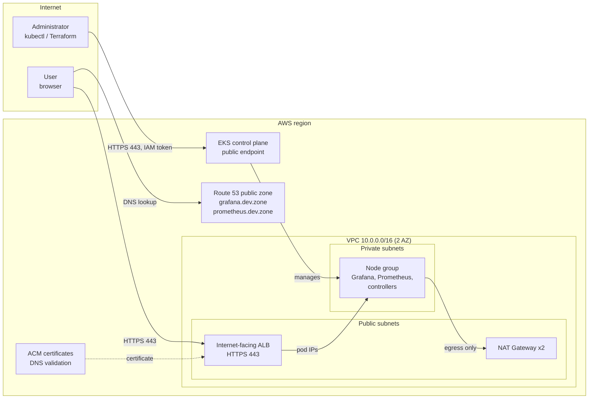
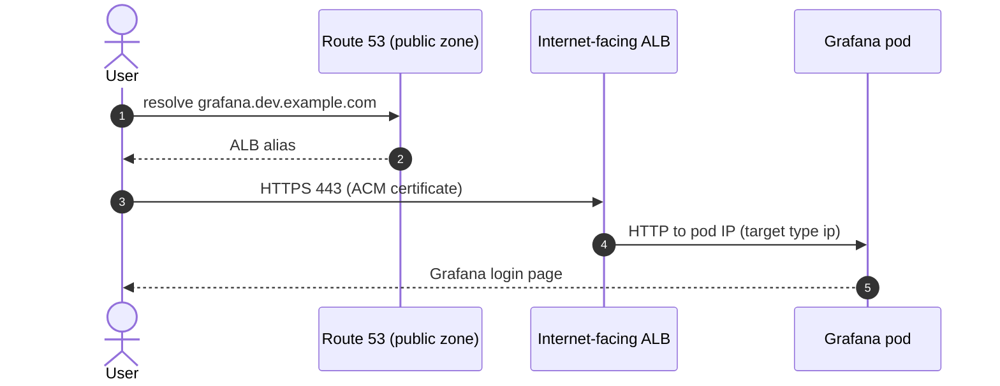
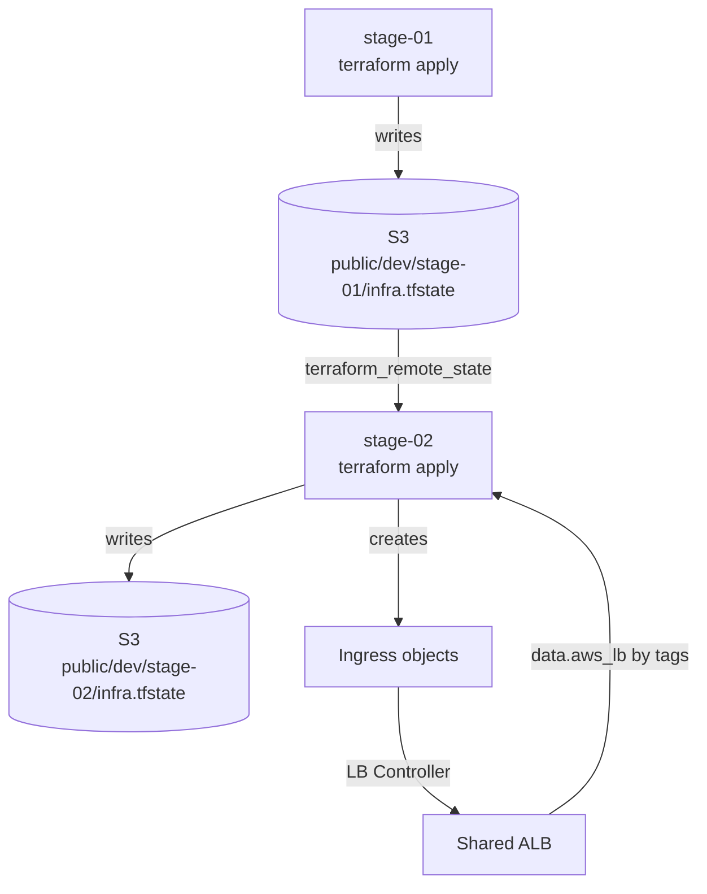
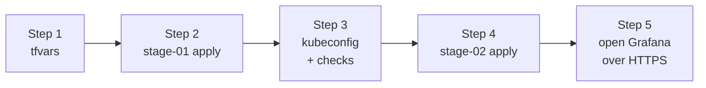

# Public EKS Cluster

Terraform code for an Amazon EKS cluster that is managed **directly from the Internet**:

- the Kubernetes API endpoint is public,
- Grafana and Prometheus are published through an **internet-facing ALB with HTTPS** and ACM certificates,
- DNS records live in the public Route 53 zone.

Worker nodes still run in private subnets behind NAT Gateways. This is the simpler variant of the project: no VPN is needed, so everything can be deployed with plain `terraform apply`. For the hardened variant, see [`../private-cluster`](../private-cluster/README.md).

Only the `dev` environment is defined.

---

## Contents

1. [Architecture](#1-architecture)
2. [Traffic flows](#2-traffic-flows)
3. [Directory structure](#3-directory-structure)
4. [Modules](#4-modules)
5. [Configuration](#5-configuration)
6. [Prerequisites](#6-prerequisites)
7. [Deployment step by step](#7-deployment-step-by-step)
8. [Destroying the environment](#8-destroying-the-environment)
9. [Known issues](#9-known-issues)

---

## 1. Architecture

| Layer | What is created |
|---|---|
| Network | VPC `10.0.0.0/16` in 2 AZs; public subnets `10.0.10.0/24`, `10.0.11.0/24`; private subnets `10.0.20.0/24`, `10.0.21.0/24`; Internet Gateway; one NAT Gateway + Elastic IP per AZ |
| Kubernetes | EKS 1.33, **public endpoint**, authentication mode `API` (access entries), managed node group in private subnets |
| Add-ons | VPC CNI, CoreDNS, kube-proxy, EKS Pod Identity Agent, Metrics Server, **kube-state-metrics**, EBS CSI Driver |
| Controllers | AWS Load Balancer Controller, Cluster Autoscaler (both use EKS Pod Identity) |
| Storage | Default StorageClass `gp3` |
| Monitoring | `kube-prometheus-stack` (Prometheus, Grafana, node-exporter) + ServiceMonitor for the kube-state-metrics add-on |
| Publishing | Internet-facing ALB (Ingress group `common-services`, HTTPS 443), ACM certificates with DNS validation, Route 53 alias records |
| State | S3 backend, encrypted, native S3 locking (`use_lockfile = true`) |



---

## 2. Traffic flows

| Flow | Path | Protection |
|---|---|---|
| Administration | Internet → public EKS endpoint (443) | IAM authentication (`aws eks get-token`) and EKS access entries; no network restriction on the endpoint |
| Monitoring UIs | Internet → Route 53 → ALB (HTTPS 443) → Grafana / Prometheus pods | TLS with ACM certificates; the Load Balancer Controller finds the certificate by the Ingress host name |
| Egress | Nodes → NAT Gateway → Internet | Nodes have no public IPs |



---

## 3. Directory structure

```text
public-cluster/
├── env/
│   └── dev/
│       ├── stage-01/          # VPC, EKS, add-ons, controllers
│       │   ├── main.tf        # backend, providers, module calls
│       │   ├── variables.tf   # inputs + locals (sizes, versions)
│       │   ├── outputs.tf     # consumed by stage-02 via remote state
│       │   └── datasource.tf
│       └── stage-02/          # monitoring, ALB Ingresses, ACM, DNS
└── modules/
    ├── stage_01/
    │   ├── vpc/               # VPC, subnets, IGW, NAT, routes
    │   ├── eks/               # cluster, node group, IAM, add-ons, SG
    │   ├── ebs-csi-driver/    # EBS CSI add-on, Pod Identity, gp3 StorageClass
    │   ├── cluster-autoscaler/
    │   └── lb-controller/
    └── stage_02/
        └── monitoring/        # kube-prometheus-stack, Ingresses, ACM, Route 53
```

---

## 4. Modules

### Stage 01 – infrastructure

| Module | Resources |
|---|---|
| `vpc` | VPC, 2 public + 2 private subnets (tagged for ALB discovery), IGW, 2 NAT GW + EIP, route tables |
| `eks` | Cluster (`endpoint_public_access = true`), node group in private subnets, IAM roles, OIDC provider, access entry for the CI/CD role, EKS add-ons incl. kube-state-metrics, additional cluster SG |
| `ebs-csi-driver` | EBS CSI add-on, Pod Identity role, default `gp3` StorageClass |
| `cluster-autoscaler` | Helm chart `cluster-autoscaler` `9.52.1`, Pod Identity role |
| `lb-controller` | Helm chart `aws-load-balancer-controller` `1.7.2`, Pod Identity role |

### Stage 02 – monitoring

| Resource | Purpose |
|---|---|
| `helm_release.kube-prometheus-stack` | Prometheus, Grafana, node-exporter in namespace `monitoring` |
| `kubernetes_manifest.kube_state_metrics_servicemonitor` | Scrapes the EKS-managed kube-state-metrics add-on in `kube-system` |
| `kubernetes_ingress_v1` `grafana` / `prometheus` | Ingress group `common-services` → one shared internet-facing ALB, HTTPS 443 |
| `aws_acm_certificate` + validation records | Certificates for `grafana.<env>.<zone>` and `prometheus.<env>.<zone>` |
| `aws_route53_record` | A aliases for both hosts → shared ALB |

### How stages are connected



Stage 02 finds the ALB created by the controller through `data "aws_lb"` filtered by tags (`account_id`, `environment`, `ingress.k8s.aws/resource`), after a 30-second `time_sleep`.

---

## 5. Configuration

Sizes and versions are set in `env/dev/stage-01/variables.tf` (`locals`):

| Setting | Value |
|---|---|
| Kubernetes version | 1.33 |
| Instance type / capacity | `t3.small` / On-Demand |
| Nodes min / desired / max | 2 / 2 / 10 |
| Additional cluster SG ingress | TCP 80, 443, 3000 from `0.0.0.0/0` (`ingress_ports`) |
| CoreDNS / kube-proxy / VPC CNI | `v1.12.4-eksbuild.1` / `v1.33.3-eksbuild.6` / `v1.20.2-eksbuild.1` |
| Pod Identity / Metrics Server / kube-state-metrics / EBS CSI | `v1.3.8-eksbuild.2` / `v0.8.0-eksbuild.2` / `v2.20.0-eksbuild.9` / `v1.50.1-eksbuild.1` |

State keys:

- `s3://terraform-states-vv/aws-eks-automation/public/dev/stage-01/infra.tfstate`
- `s3://terraform-states-vv/aws-eks-automation/public/dev/stage-02/infra.tfstate`

---

## 6. Prerequisites

- Terraform `>= 1.5`, AWS CLI v2, `kubectl`, `helm`
- An S3 bucket for Terraform state (the code uses `terraform-states-vv` in `us-east-1`)
- A **public** Route 53 hosted zone for the monitoring host names
- An IAM role for automation (for example a GitHub Actions role); it gets an EKS access entry

---

## 7. Deployment step by step



### Step 1 – Create `terraform.tfvars`

The repository does not contain tfvars for this project. Create them:

`env/dev/stage-01/terraform.tfvars`

```hcl
automation_role_arn = "arn:aws:iam::<account-id>:role/<ci-role>"
env                 = "dev"
prefix_name         = "incubator-lab"
region              = "us-east-1"
```

`env/dev/stage-02/terraform.tfvars`

```hcl
hosted_zone_name = "example.com"
```

### Step 2 – Stage 01: network, cluster and controllers

```bash
cd env/dev/stage-01
terraform init
terraform plan
terraform apply
```

The API endpoint is public, so a single apply creates the VPC, the EKS cluster, the add-ons and the Helm releases. It takes about 15–20 minutes.

### Step 3 – Configure `kubectl` and check the cluster

```bash
aws eks update-kubeconfig --name incubator-lab-dev --region us-east-1
kubectl get nodes -o wide
kubectl get pods -n kube-system
kubectl get storageclass
```

Expected: nodes `Ready` with private IPs; Load Balancer Controller, Cluster Autoscaler, EBS CSI and kube-state-metrics pods `Running`.

### Step 4 – Stage 02: monitoring and HTTPS publishing

```bash
cd ../stage-02
terraform init
terraform plan
terraform apply
```

Stage 02 installs `kube-prometheus-stack`, creates the two Ingresses (the controller builds one shared ALB), requests and validates the ACM certificates and creates the Route 53 records.

```bash
terraform output
kubectl get ingress -n monitoring
```

### Step 5 – Open the monitoring UIs

- `https://grafana.dev.example.com`
- `https://prometheus.dev.example.com`

User `admin`; the password is generated randomly by the Grafana chart on first install and stored only in the cluster:

```bash
kubectl get secret -n monitoring kube-prometheus-stack-grafana \
  -o jsonpath='{.data.admin-password}' | base64 -d; echo
```

The UIs are reachable from the whole Internet, so keep this password secret and consider SSO or an IP allow-list on the ALB.

---

## 8. Destroying the environment

```bash
cd env/dev/stage-02 && terraform destroy   # Ingresses, ALB, certificates, DNS
cd ../stage-01     && terraform destroy   # controllers, EKS, NAT, VPC
```

Destroy stage-02 first, so the Load Balancer Controller can delete the ALB before the VPC is removed.

---

## 9. Known issues

- **Two default StorageClasses** – the `gp3` class uses the in-tree provisioner `kubernetes.io/aws-ebs` (handled by CSI migration) and EKS's `gp2` stays marked as default. The private variant uses `ebs.csi.aws.com` and removes the flag from `gp2`.
- **Exposure** – the Kubernetes API, Grafana and Prometheus are reachable from the Internet and the additional cluster SG allows 80/443/3000 from `0.0.0.0/0`. Use this variant for labs and demos; use [`private-cluster`](../private-cluster/README.md) for anything long-lived.
